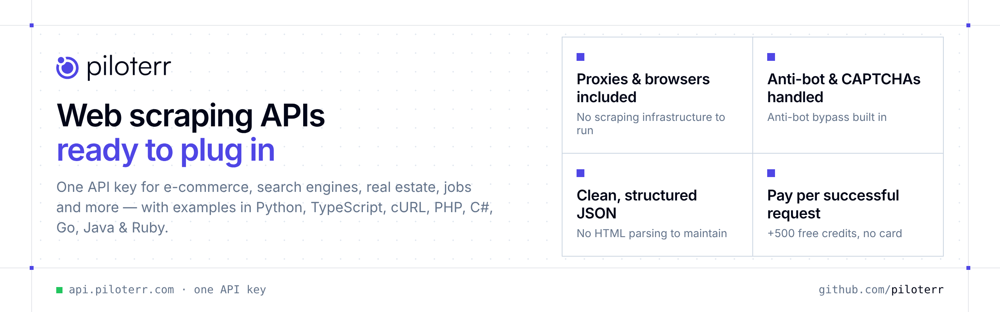

<p align="center">
  <a href="https://www.piloterr.com"></a>
</p>

<p align="center">

[](https://discord.gg/CFj3ph8aHU) [](https://www.piloterr.com) [](https://app.piloterr.com) [](https://app.piloterr.com/openapi)

</p>

**Piloterr** turns websites into **structured JSON APIs**. Each repository below documents one scraper API with
Python and TypeScript examples, plus cURL, PHP, C#, Go, Java, Ruby and Node.js in its `examples/` folder.
No proxies, headless browsers or HTML parsing to maintain — one API key, `x-api-key` header, JSON out.

### Why Piloterr?

- 🌐 **Proxies & headless browsers included** — no scraping infrastructure to build or maintain.
- 🛡️ **Anti-bot & CAPTCHAs handled** — anti-bot bypass is built in, so your pipelines keep running.
- 🧩 **Clean, structured JSON** — documented fields instead of brittle HTML selectors.
- 💳 **Pay per successful request** — start with +500 free credits, no credit card required.
- 🔑 **One API key, one header** — the same `x-api-key` for every website in the list below.
- 🧑‍💻 **Copy-paste examples** — Python and TypeScript in each README, 7 more languages in `examples/`.

```bash
curl -G https://api.piloterr.com/v2/amazon/search \
  -H "x-api-key: $PILOTERR_API_KEY" \
  --data-urlencode "query=playstation 5"
```

### 🛒 E-commerce & retail

[About You](https://github.com/piloterr/aboutyou-scraper) · [Action](https://github.com/piloterr/action-scraper) · [Aldi](https://github.com/piloterr/aldi-scraper) · [Alibaba](https://github.com/piloterr/alibaba-scraper) · [AliExpress](https://github.com/piloterr/aliexpress-scraper) · [Allegro](https://github.com/piloterr/allegro-scraper) · [Amazon](https://github.com/piloterr/amazon-scraper) · [Argos](https://github.com/piloterr/argos-scraper) · [Auchan](https://github.com/piloterr/auchan-scraper) · [Autodoc](https://github.com/piloterr/autodoc-scraper) · [Best Buy](https://github.com/piloterr/bestbuy-scraper) · [Bol](https://github.com/piloterr/bol-scraper) · [Boulanger](https://github.com/piloterr/boulanger-scraper) · [Brico Dépôt](https://github.com/piloterr/bricodepot-scraper) · [Bricorama](https://github.com/piloterr/bricorama-scraper) · [Carrefour](https://github.com/piloterr/carrefour-scraper) · [Castorama](https://github.com/piloterr/castorama-scraper) · [Cdiscount](https://github.com/piloterr/cdiscount-scraper) · [Chewy](https://github.com/piloterr/chewy-scraper) · [Coolblue](https://github.com/piloterr/coolblue-scraper) · [Costco](https://github.com/piloterr/costco-scraper) · [Cultura](https://github.com/piloterr/cultura-scraper) · [Darty](https://github.com/piloterr/darty-scraper) · [Decathlon](https://github.com/piloterr/decathlon-scraper) · [DigiKey](https://github.com/piloterr/digikey-scraper) · [E.Leclerc](https://github.com/piloterr/eleclerc-scraper) · [eBay](https://github.com/piloterr/ebay-scraper) · [El Corte Inglés](https://github.com/piloterr/elcorteingles-scraper) · [Grainger](https://github.com/piloterr/grainger-scraper) · [Idealo](https://github.com/piloterr/idealo-scraper) · [IKEA](https://github.com/piloterr/ikea-scraper) · [Intermarché](https://github.com/piloterr/intermarche-scraper) · [Intersport](https://github.com/piloterr/intersport-scraper) · [Kroger](https://github.com/piloterr/kroger-scraper) · [Lenovo](https://github.com/piloterr/lenovo-scraper) · [Leroy Merlin](https://github.com/piloterr/leroymerlin-scraper) · [Lidl](https://github.com/piloterr/lidl-scraper) · [ManoMano](https://github.com/piloterr/manomano-scraper) · [MediaMarkt](https://github.com/piloterr/mediamarkt-scraper) · [Mr.Bricolage](https://github.com/piloterr/mrbricolage-scraper) · [Newegg](https://github.com/piloterr/newegg-scraper) · [Oscaro](https://github.com/piloterr/oscaro-scraper) · [Picard](https://github.com/piloterr/picard-scraper) · [Point.P](https://github.com/piloterr/pointp-scraper) · [Reverb](https://github.com/piloterr/reverb-scraper) · [Rexel](https://github.com/piloterr/rexel-scraper) · [Sephora](https://github.com/piloterr/sephora-scraper) · [Shophouzz](https://github.com/piloterr/shophouzz-scraper) · [Shopify](https://github.com/piloterr/shopify-scraper) · [SnapEDA](https://github.com/piloterr/snapeda-scraper) · [Starbucks](https://github.com/piloterr/starbucks-scraper) · [StockX](https://github.com/piloterr/stockx-scraper) · [Target](https://github.com/piloterr/target-scraper) · [Thalia](https://github.com/piloterr/thalia-scraper) · [Walmart](https://github.com/piloterr/walmart-scraper) · [Zooplus](https://github.com/piloterr/zooplus-scraper)

### 🚗 Marketplaces, classifieds & vehicles

[AutoScout24](https://github.com/piloterr/autoscout24-scraper) · [Autotrader](https://github.com/piloterr/autotrader-scraper) · [Copart](https://github.com/piloterr/copart-scraper) · [Kijiji](https://github.com/piloterr/kijiji-scraper) · [Leboncoin](https://github.com/piloterr/leboncoin-scraper) · [Mascus](https://github.com/piloterr/mascus-scraper) · [mobile.de](https://github.com/piloterr/mobile-de-scraper) · [OLX](https://github.com/piloterr/olx-scraper) · [Ovoko](https://github.com/piloterr/ovoko-scraper) · [Trade-A-Plane](https://github.com/piloterr/tradeaplane-scraper) · [Vinted](https://github.com/piloterr/vinted-scraper)

### 🔎 Search engines (SERP)

[Bing](https://github.com/piloterr/bing-scraper) · [Brave](https://github.com/piloterr/brave-scraper) · [Google](https://github.com/piloterr/google-scraper) · [Google Ads Transparency](https://github.com/piloterr/googleadstransparency-scraper)

### 🏠 Real estate

[Apartments](https://github.com/piloterr/apartments-scraper) · [Argenprop](https://github.com/piloterr/argenprop-scraper) · [Centris](https://github.com/piloterr/centris-scraper) · [Fotocasa](https://github.com/piloterr/fotocasa-scraper) · [Funda](https://github.com/piloterr/funda-scraper) · [Homestra](https://github.com/piloterr/homestra-scraper) · [Idealista](https://github.com/piloterr/idealista-scraper) · [ImmobilienScout24](https://github.com/piloterr/immobilienscout24-scraper) · [Immowelt](https://github.com/piloterr/immowelt-scraper) · [Lamudi](https://github.com/piloterr/lamudi-scraper) · [Realtor.com](https://github.com/piloterr/realtor-scraper) · [SeLoger](https://github.com/piloterr/seloger-scraper) · [Viva Real](https://github.com/piloterr/vivareal-scraper) · [Zap Imóveis](https://github.com/piloterr/zapimoveis-scraper) · [Zillow](https://github.com/piloterr/zillow-scraper) · [ZonaProp](https://github.com/piloterr/zonaprop-scraper) · [Zoopla](https://github.com/piloterr/zoopla-scraper)

### 🏢 Companies, jobs & B2B data

[Company Database](https://github.com/piloterr/company-data-api) · [Crunchbase](https://github.com/piloterr/crunchbase-scraper) · [Europages](https://github.com/piloterr/europages-scraper) · [Fiverr](https://github.com/piloterr/fiverr-scraper) · [Glassdoor](https://github.com/piloterr/glassdoor-scraper) · [Indeed](https://github.com/piloterr/indeed-scraper) · [North Data](https://github.com/piloterr/northdata-scraper) · [Ocean.io](https://github.com/piloterr/oceanio-scraper) · [Owler](https://github.com/piloterr/owler-scraper) · [PagesJaunes](https://github.com/piloterr/pagesjaunes-scraper) · [PitchBook](https://github.com/piloterr/pitchbook-scraper) · [Similarweb](https://github.com/piloterr/similarweb-scraper) · [TED (EU tenders)](https://github.com/piloterr/ted-scraper) · [Thomasnet](https://github.com/piloterr/thomasnet-scraper) · [Trustpilot](https://github.com/piloterr/trustpilot-scraper) · [Upwork](https://github.com/piloterr/upwork-scraper) · [Welcome to the Jungle](https://github.com/piloterr/welcometothejungle-scraper) · [Yellowpages](https://github.com/piloterr/yellowpages-scraper)

### 💬 Social media

[Instagram](https://github.com/piloterr/instagram-scraper) · [Kick](https://github.com/piloterr/kick-scraper) · [Patreon](https://github.com/piloterr/patreon-scraper) · [Pinterest](https://github.com/piloterr/pinterest-scraper) · [TikTok Top Ads](https://github.com/piloterr/tiktoktopads-scraper) · [X (Twitter)](https://github.com/piloterr/twitter-x-scraper)

### ✈️ Travel, local & logistics

[Auto Europe](https://github.com/piloterr/autoeurope-scraper) · [Eventbrite](https://github.com/piloterr/eventbrite-scraper) · [Expedia](https://github.com/piloterr/expedia-scraper) · [Maersk](https://github.com/piloterr/maersk-scraper) · [TheFork](https://github.com/piloterr/thefork-scraper) · [Yelp](https://github.com/piloterr/yelp-scraper)

### 🧰 Web scraping tools & enrichment

[Domain Intelligence](https://github.com/piloterr/domain-lookup-api) · [Email Finder & Verifier](https://github.com/piloterr/email-finder-api) · [Website Scraping](https://github.com/piloterr/website-scraper-api)

---

💬 [Discord](https://discord.gg/CFj3ph8aHU) · 📚 [API reference](https://app.piloterr.com/openapi) · 🔑 [Get your API key](https://app.piloterr.com) · 🌐 [piloterr.com](https://www.piloterr.com)
